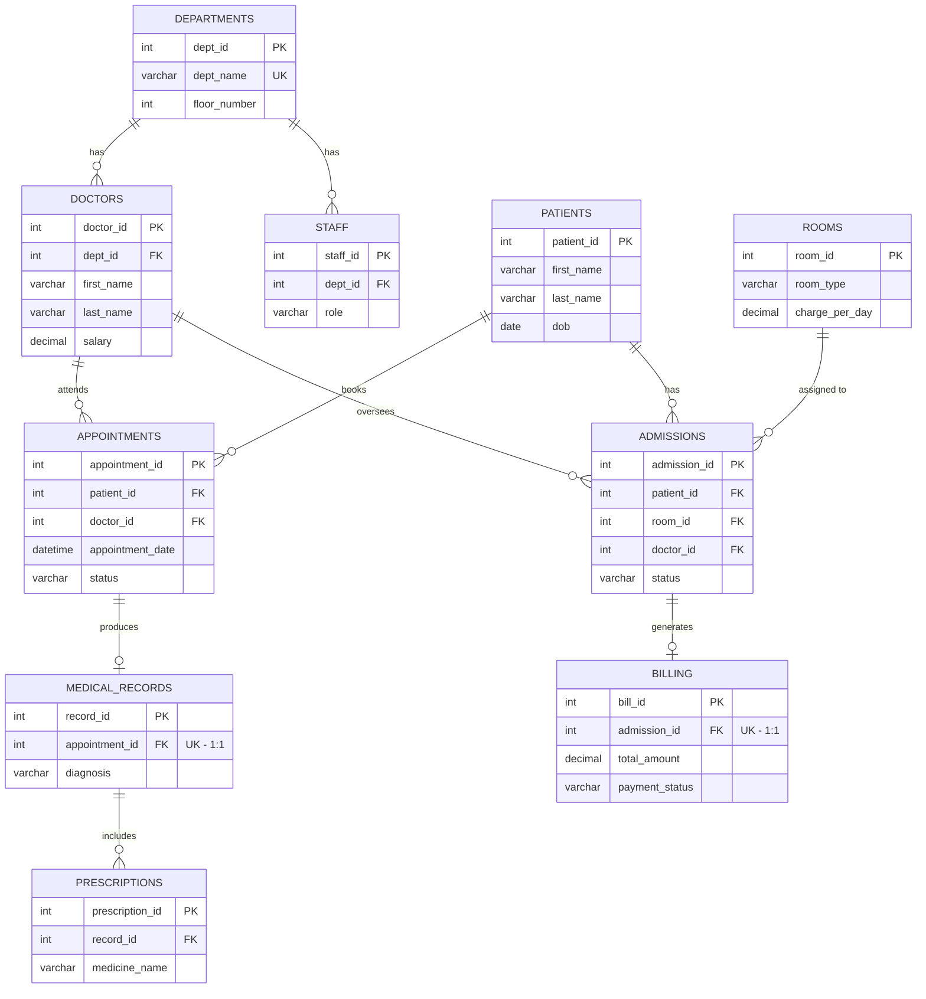

# Hospital Management System — SQL Project

A MySQL relational database project simulating a real-world hospital's
operations — patients, doctors, appointments, medical records, admissions,
and billing — built to practice SQL from basic to advanced level.

## Project Overview

This project models a hospital's day-to-day data across 10 related tables,
covering the full patient journey: registration → appointment booking →
diagnosis/prescription → (optionally) admission → billing. It was designed
to demonstrate proper relational design (normalization, primary/foreign keys,
constraints) and to serve as a practice ground for SQL querying — from basic
`SELECT`/`WHERE` statements up to window functions, CTEs, correlated
subqueries, views, procedures, and triggers.

**Scale:** ~8,000 records across all 10 tables, generated to be internally
consistent (e.g., billing amounts are calculated from actual room rates and
stay durations, not random numbers).

## ER Diagram


*(Renders automatically on GitHub and in most Markdown viewers with Mermaid support.)*

**Text-based fallback** (if Mermaid doesn't render in your viewer):
```
departments (1) ───< doctors (M)
departments (1) ───< staff (M)
patients (1)    ───< appointments (M) ───o| medical_records (1) ───< prescriptions (M)
doctors (1)     ───< appointments (M)
patients (1)    ───< admissions (M) ───o| billing (1)
rooms (1)       ───< admissions (M)
doctors (1)     ───< admissions (M)

Legend:  ───<  one-to-many      ───o|  one-to-one
```

## Schema Summary (10 Tables)

| # | Table | Purpose | Key Relationships |
|---|---|---|---|
| 1 | `departments` | Hospital departments (Cardiology, ENT, etc.) | Parent to `doctors`, `staff` |
| 2 | `rooms` | Physical rooms/wards available for admission | Parent to `admissions` |
| 3 | `doctors` | Doctor records | Belongs to `departments`; parent to `appointments`, `admissions` |
| 4 | `staff` | Nurses, admin, lab techs, pharmacists | Belongs to `departments` |
| 5 | `patients` | Patient master data | Parent to `appointments`, `admissions` |
| 6 | `appointments` | Patient–doctor visit bookings | Belongs to `patients` + `doctors`; parent to `medical_records` |
| 7 | `medical_records` | Diagnosis/treatment per appointment (1-to-1) | Belongs to `appointments`; parent to `prescriptions` |
| 8 | `prescriptions` | Medicines prescribed per record | Belongs to `medical_records` |
| 9 | `admissions` | In-patient stays | Belongs to `patients`, `rooms`, `doctors`; parent to `billing` |
| 10 | `billing` | One bill per admission (1-to-1) | Belongs to `admissions` |

**Relationship types:**
- One-to-many: `departments`→`doctors`, `departments`→`staff`, `patients`→`appointments`, `patients`→`admissions`, `doctors`→`appointments`, `rooms`→`admissions`, `medical_records`→`prescriptions`
- One-to-one: `appointments`↔`medical_records`, `admissions`↔`billing`

**Foreign key behavior:** `CASCADE` is used where child data is meaningless
without its parent (e.g., deleting a patient removes their appointments).
`RESTRICT` is used to protect structural entities (e.g., a department can't
be deleted while doctors are still assigned to it).

## Advanced Features

Implemented in `advanced_features.sql`, run after the sample data is loaded:

| Type | Name | Purpose |
|---|---|---|
| **View** | `vw_icu_patients` | Currently admitted ICU patients, with room and attending doctor |
| **View** | `vw_revenue_summary` | Monthly revenue, bill count, and average bill from `billing` |
| **Procedure** | `sp_patient_history(patient_id)` | Full visit history for one patient — every appointment, doctor, diagnosis |
| **Trigger** | `trg_billing_after_discharge` | Fires `AFTER UPDATE ON admissions`; auto-generates the bill (room charges × stay length + doctor fee + other charges) the moment a patient's status flips to `Discharged` |
| **Indexes** | `idx_appointments_doctor_id`, `idx_appointments_patient_id`, `idx_admissions_patient_id`, `idx_admissions_doctor_id` | Speed up the JOINs and filters used throughout the practice queries and reports |

```sql
-- Example usage
SELECT * FROM vw_icu_patients;
SELECT * FROM vw_revenue_summary ORDER BY revenue_month;
CALL sp_patient_history(5);
```

## How to Run

Run the scripts **in this exact order** — each step depends on the one before it.

| Step | File | What it does |
|---|---|---|
| 1 | `hospital_schema.sql` | **DDL** — creates the `hospital_management` database and all 10 tables, with PK/FK/CHECK constraints, in dependency order |
| 2 | `hospital_data.sql` | **DML** — inserts ~8,000 rows of realistic, FK-consistent sample data |
| 3 | `advanced_features.sql` | **Views/Procedure/Trigger/Indexes** — run after data is loaded, so views and the procedure have real rows to query |
| 4 | `reports.sql` / `answer_key.sql` | **Queries** — dashboard reports and the 45 practice queries |

### Setup instructions
```bash
# 1. Log into MySQL
mysql -u root -p

# 2. Run the schema file (creates DB + tables)
source hospital_schema.sql;

# 3. Run the data file (populates ~8,000 rows)
source hospital_data.sql;

# 4. Create views, the procedure, trigger, and indexes
source advanced_features.sql;

# 5. Run the reports or any query from the answer key
source reports.sql;
source answer_key.sql;
```
Or, if using MySQL Workbench: open each `.sql` file and execute it top to
bottom, in the order above, against the `hospital_management` schema.

**Note:** `hospital_data.sql` temporarily disables `FOREIGN_KEY_CHECKS`
during the bulk insert and re-enables it at the end — this is expected and
does not affect data integrity, since all values are already generated to
satisfy the FK relationships.

## Example Outputs

A few sample results from running practice queries against the actual generated dataset:

**Q1 — List doctors (first 5 rows shown):**

| first_name | last_name | specialization |
|---|---|---|
| Hitesh | Murty | General Physician |
| Karan | Sangha | General Physician |
| Christopher | Dutta | General Physician |
| Aashi | Contractor | Surgeon |
| Lekha | Gokhale | Consultant |

**Q17 — Total patient count:**
```
total_patients
1720
```

**Q18 — Average doctor salary per department (first 4 rows):**

| dept_name | avg_salary |
|---|---|
| Cardiology | 158154.71 |
| Dermatology | 161470.27 |
| ENT | 165101.75 |
| General Medicine | 156599.40 |

**Q19 — Total billing amount collected (payment_status = 'Paid'):**
```
total_collected
42,482,570
```

## Use Cases / Reports

Three dashboard-style reports (`reports.sql`), with real output from the generated dataset.

### Report 1 — Monthly Revenue
```sql
SELECT DATE_FORMAT(bill_date, '%Y-%m') AS month,
       SUM(total_amount) AS monthly_revenue,
       COUNT(*) AS num_bills
FROM billing
GROUP BY DATE_FORMAT(bill_date, '%Y-%m')
ORDER BY month;
```
| month | monthly_revenue | num_bills |
|---|---|---|
| 2024-10 | 2,440,454 | 5 |
| 2024-11 | 110,568 | 3 |
| 2024-12 | 321,393 | 6 |
| 2025-01 | 7,006,412 | 11 |
| 2025-02 | 4,428,819 | 4 |
| 2025-03 | 11,807,022 | 13 |

*(Full table has one row per month across the ~2-year admission history.)*

### Report 2 — Top 5 Doctors by Revenue Generated
```sql
SELECT doc.doctor_id, CONCAT(doc.first_name,' ',doc.last_name) AS doctor_name,
       dep.dept_name, SUM(ap.fee) AS total_revenue, COUNT(*) AS total_appointments
FROM appointments ap
JOIN doctors doc ON ap.doctor_id = doc.doctor_id
JOIN departments dep ON doc.dept_id = dep.dept_id
WHERE ap.status = 'Completed'
GROUP BY doc.doctor_id, doc.first_name, doc.last_name, dep.dept_name
ORDER BY total_revenue DESC
LIMIT 5;
```
| doctor_id | doctor_name | dept_name | total_revenue | total_appointments |
|---|---|---|---|---|
| 63 | Hardik Kar | ENT | 33,600 | 38 |
| 9 | Jeevika Bail | Neurology | 32,700 | 40 |
| 70 | Theodore Sundaram | Neurology | 28,700 | 32 |
| 2 | Karan Sangha | ENT | 28,500 | 34 |
| 20 | Hredhaan Deo | ENT | 28,300 | 32 |

### Report 3 — Average Patient Stay Duration by Room Type
```sql
SELECT r.room_type,
       ROUND(AVG(DATEDIFF(ad.discharge_date, ad.admission_date)), 1) AS avg_stay_days,
       COUNT(*) AS num_admissions
FROM admissions ad
JOIN rooms r ON ad.room_id = r.room_id
WHERE ad.discharge_date IS NOT NULL
GROUP BY r.room_type
ORDER BY avg_stay_days DESC;
```
| room_type | avg_stay_days | num_admissions |
|---|---|---|
| General | 11.7 | 23 |
| Operation Theatre | 10.4 | 20 |
| Private | 10.3 | 25 |
| ICU | 9.1 | 25 |
| Semi-Private | 9.1 | 18 |

*(Interesting real pattern in the data: General ward stays run longer on
average than ICU stays — worth a sentence in your report explaining why,
e.g. ICU cases are typically short and acute, while general ward covers
longer recovery periods.)*

## Row Counts by Table

| Table | Rows |
|---|---|
| departments | 10 |
| rooms | 60 |
| doctors | 70 |
| staff | 140 |
| patients | 1,720 |
| appointments | 3,000 |
| medical_records | 1,200 |
| prescriptions | 1,500 |
| admissions | 150 |
| billing | 150 |
| **Total** | **8,000** |

## Files in This Project

```
hospital_schema.sql      -- DDL: database + 10 tables with constraints
hospital_data.sql        -- DML: ~8,000 rows of sample data
advanced_features.sql    -- Views, stored procedure, trigger, indexes
reports.sql              -- 3 dashboard-style report queries
practice_questions.md    -- 45 SQL practice questions (Basic/Intermediate/Advanced)
answer_key.sql           -- Full solutions to all 45 practice questions
README.md                -- This file
```
